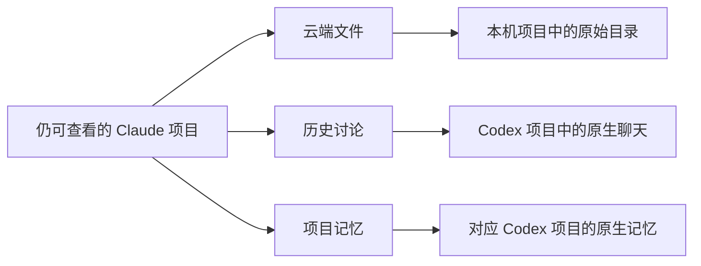

# Claude Cloud to Codex

**用 Claude Projects 开发或做其他任务时，文件、对话和项目记忆可能只在云端。**账号被封或无法重新登录后，设置里的「导出数据」也可能拿不全。只要原先登录的桌面端还能打开项目，这套 Codex skill 和 Windows 工具就能帮你抢救可读内容，还原目录、逐个迁移对话并恢复记忆。

这套工具来自一次实际迁移：旧项目仍能在 Claude 桌面端打开，历史讨论也翻得到，但已经不能发新消息。云端文件菜单只能逐个下载，复制出来的 `/mnt/project-files/…` 也是云端路径。我们先盘点已有导出，再从仍能查看的项目里补回缺项。

要跟着做，先在原来登录的 Windows 桌面端试三件事：打开一个旧讨论、查看一条记忆、下载一个小文件。哪一类还能读，就能从那一类开始。若旧会话也已失效，手头留存的导出和手动下载仍可用于离线恢复。

[安装与开始](#安装与开始) · [用户与 Codex 的分工](#使用者与-codex-如何配合) · [English quick start](#english-quick-start)

## 迁移后会得到什么



| 假设旧项目里有… | 打开迁好的 Codex 项目时，你会看到… |
| --- | --- |
| `src/config.json` 和 `tests/config.json` 两个同名文件 | 两个文件各在原来的目录。下载中途取消后，可以核对已有文件再续传。 |
| 一个主讨论和两个分支讨论 | 三个可分别打开的原生聊天。逐串核对发言人、顺序、首尾和记录数。 |
| 一条旧决定，以及两天后修改它的记录 | 两条记录连同先后关系进入同一项目的记忆。导入完成后回读，核对正文和项目归属。 |

能复制的正文优先按原文取回。遇到只能查看的记忆页，可以截取指定窗口区域，再按原页核对转录。附件原件需要从下载入口取回；链接已经失效时，只能记录它曾出现在哪段对话。

## 安装与开始

在 Codex 中发送以下请求即可安装。也可下载仓库，把整个 `skills/claude-cloud-to-codex` 目录放进宿主发现技能的用户目录，如 `~/.agents/skills/`，使最终路径为 `~/.agents/skills/claude-cloud-to-codex/SKILL.md`。在新聊天中输入技能名验证发现结果。[Codex skills 文档](https://developers.openai.com/codex/skills/)

```text
请用 $skill-installer 从 GitHub 仓库 Earendilcc/claude-cloud-to-codex 安装路径 skills/claude-cloud-to-codex 下的 skill。
```

安装后，可以在目标 Codex 项目里用这段话发起迁移。

```text
请用 $claude-cloud-to-codex 迁移我当前在 Claude 桌面打开的云项目。Claude 无法继续对话。
请先确认来源和目标，检查旧导出缺了哪些文件，再恢复原始目录、项目记忆和每一个原对话。
允许读取这个项目。正式写入前说明要写到哪里。核对成功后清理这次的临时截图和转录。
```

## 使用者与 Codex 如何配合

| 阶段 | 使用者做什么 | Codex 做什么 | 如何确认结果 |
| --- | --- | --- | --- |
| 确定范围 | 打开已登录的 Claude 项目，指出对应的现有 Codex 项目，以及需要文件、记忆或聊天中的哪几项 | 对照现有导出、工作树和目标聊天；必要时只请用户复制一条原对话链接或一个文件路径 | 双方确认源项目与目标根目录 |
| 取得源文件 | 允许读取所选窗口，必要时展开目录或处理系统保存窗口 | 逐项下载和续传，按源相对路径还原，同名分开；失效项保留出处 | 逐文件检查相对路径、字节数和哈希，空目录也可核对 |
| 读取历史和记忆 | 若界面无法自动翻页，协助切到指定页或确认一处模糊文字 | 从主频道和各讨论读取完整历史；能复制时复制，只能看时再截图、转录、复核 | 逐串核对首尾、数量、发言人和顺序；记忆逐项核对时间和修订 |
| 写入 Codex | 按自己的宿主权限批准写入指定项目和本机 Codex 状态 | 先用隔离配置演练，再导入、回读、绑定桌面侧栏；说明无法获取的原件 | 每个源对话对应一个原生聊天，记忆落到相应作用域 |
| 恢复开发（按需） | 指定需要续做的内容、现用分支和可覆盖的范围 | 比对正式源码、构建物、进行中快照；在独立副本恢复测试与交付入口 | 用项目原有的测试和构建证明能接续开发 |

**权限随步骤开启。** 盘点只读源资料，桌面采集需要访问所选窗口（复制路径或原文时还会使用系统剪贴板），下载和截图需要写入私有暂存区。恢复文件时才需要目标目录写权限，正式导入聊天或记忆时才需要本机 Codex 状态目录写权限。实际弹窗由宿主和组织策略决定。用户若只能手动下载或截图，可直接把这些材料交给后续离线工具，不必把 Claude 的登录信息交给 Codex。

## 工具和适用环境

| 要完成的事 | 入口 |
| --- | --- |
| 查看完整流程、权限清单及验收标准 | [SKILL.md](skills/claude-cloud-to-codex/SKILL.md) |
| 操作已登录的 Windows 客户端，按文件批量下载或补收 | [下载工具和用法](skills/claude-cloud-to-codex/references/windows-download.md) |
| 给所选窗口或正文区域截图，按页转录 | [截图工具和用法](skills/claude-cloud-to-codex/references/windows-capture.md) |
| 从指定聊天窗口读取当前可见的消息行和链接，辅助翻页查漏 | [只读分页工具](skills/claude-cloud-to-codex/scripts/claude-chat-page.ps1)及[原文核对步骤](skills/claude-cloud-to-codex/references/claude-desktop.md) |
| 用 Python 从已经下载的文件重建原目录，预检冲突、校验哈希 | [源端清点、重建和采集长对话](skills/claude-cloud-to-codex/references/claude-desktop.md) |
| 用 Node.js 在隔离配置验证聊天导入，再按来源 ID 写入和回读 | [原生聊天清单、命令和恢复办法](skills/claude-cloud-to-codex/references/native-chats.md) |
| 测试本机原生记忆入口，再按项目导入 | [记忆探针和导入步骤](skills/claude-cloud-to-codex/references/project-memory.md) |
| 判定云端与本机哪个版本可用，恢复遗留工具和未交付内容 | [接续开发](skills/claude-cloud-to-codex/references/resume-development.md) |

桌面工具面向 Windows 上仍可读的 Claude 客户端，需要允许操作指定窗口。磁盘恢复工具使用 Python 3 标准库；聊天和记忆工具使用 Node.js 与本机 Codex 的 app-server。Windows、Node.js 24 和 Codex CLI `0.171.0-alpha.13.2` 是本次验证环境。其他版本或平台先跑隔离测试，按本机协议确认实现。不同工作区、组织策略和客户端可能提供不同能力。[Codex app-server 文档](https://developers.openai.com/codex/app-server/)

想先试工具，可从已安装的 skill 目录运行以下命令。前两条使用虚构数据，第三条只列出可选择的 Claude 窗口。取得窗口句柄后，再按下载指南用 `Plan` 枚举指定目录、`Download` 保存原件或 `Adopt` 补进用户手动下载的文件。Windows 下载适配器需要 PowerShell 7。

```powershell
node scripts/self-test.mjs
node scripts/probe-memory.mjs
pwsh -NoProfile -File scripts/claude-download.ps1 -Mode Inspect
```

本仓库用虚构项目跑过聊天和记忆的原生回读、重复导入、跨项目同名、文件恢复冲突及断点续传。Windows 端另用测试窗口核对了截图像素，并用系统“另存为”对话框实际保存和回读了测试文件。公开版未在他人的 Claude 账号上运行。不同客户端的菜单、语言或可访问性标识可能变化，先用本人的一个小文件和一张截图确认，再扩大范围。

**能迁回的范围取决于源端还保留什么。** 可复制的发言能按原文核对；只能预览的图片可保留来源引用；已失效的附件链接无法还原原始字节。截图不能证明已经下载了附件。本仓库用于分享方法和工具，迁移过程中得到的私有资料应保存在使用者自己的环境中。

## English quick start

Locked out of Claude? If your desktop still opens the project, recover cloud files, chats and memory the data export missed. Restore the file tree and import each conversation as a native Codex chat.

Start with a small check in the Windows desktop session that was already signed in. Open an old conversation, view a memory entry, and try downloading one file. If the session has expired, start with any exports and downloads you already have.

In Codex, install the skill with the prompt below. Then open the destination project in a new chat, invoke `$claude-cloud-to-codex`, and identify the source project. Codex can inventory missing items, rehearse the import in isolation, and read back the results before temporary captures are removed.

```text
Use $skill-installer to install skills/claude-cloud-to-codex from Earendilcc/claude-cloud-to-codex on GitHub.
```

## 许可

仓库中的 skill、说明和工具按 [MIT 许可证](LICENSE) 发布。使用者迁入的原始资料继续适用其原有权利和许可。
